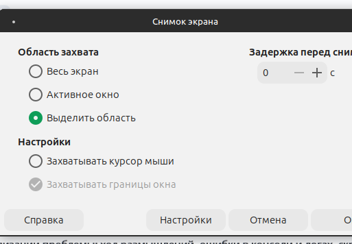

## Шаги воспроизведения

1. Шаг 1
2. Шаг 2
3. Шаг 3
   
| Заголовок 1 | Заголовок 2 |
| --- | --- |
| Ячейка 1 | Ячейка 2 |

## Документация

Описание работы системы по документации. Пункт должен отвечать на вопрос, избыточное ли это требование или дефект анализа/разработки. Обязательно прикладывать выдержку из документа, которая чётко отражает процесс. Ключевые места выделить **жирным шрифтом**. При отсутствии описания также фиксировать это с названиями документов, в которых осуществлялся поиск (при отсутствии описаний требуется заводить отдельный дефект документации на команды развития).

## Локализация

Описание проделанных шагов для локализации проблемы: ход размышлений, ошибки в консоли и логах, скриншоты.



```bash
sudo apt update
```

Описание места проблемы и её причины.

## Варианты исправлений

Возможные рекомендации по исправлению. При отсутствии вариантов передать дефект на анализ разработчикам команды поддержки.
