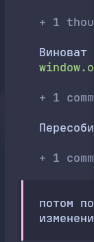

## Шаги воспроизведения

1. Открыть раздел «Комментарии» под пользователем с ролью «Оператор».
2. Выполнить действие, после которого раздел возвращает 403.
3. Проверить ответ кэш Redis в инструментах разработчика и журнале приложения.
4. Повторить операцию после очистки кэша браузера.

## Документация

В «Руководстве администратора», раздел «Комментарии», указано: **после изменения настроек раздел должен обновиться без перезагрузки**, а обращения к кэш Redis должны логироваться с идентификатором запроса.

В «Спецификации API» для соответствующего метода зафиксирован ответ **200 OK и актуальные данные в течение 2 секунд**. Отклонение от этого поведения считаем дефектом, а не требованием поддержки.

## Локализация

Проблема воспроизводится стабильно на стенде. В журнале кэш Redis видно:

```text
ERROR кэш Redis: operation failed
area=Комментарии
traceId=4f2c9a7e-51194
```

По шагам удалось сузить область: ошибка возникает после действия, когда раздел возвращает 403. В браузере запрос завершается кодом 500, в логах — исключение при обработке данных.

Причина: неверный формат даты.

## Варианты исправлений

- Привести даты к UTC.
- Добавить регрессионный тест на сценарий и проверку кода ответа.
- Проверить соседние сценарии раздела, чтобы исключить ту же причину.
